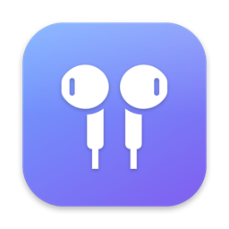
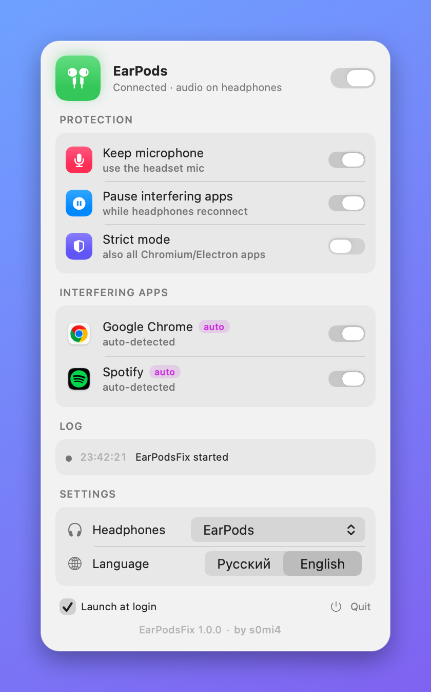
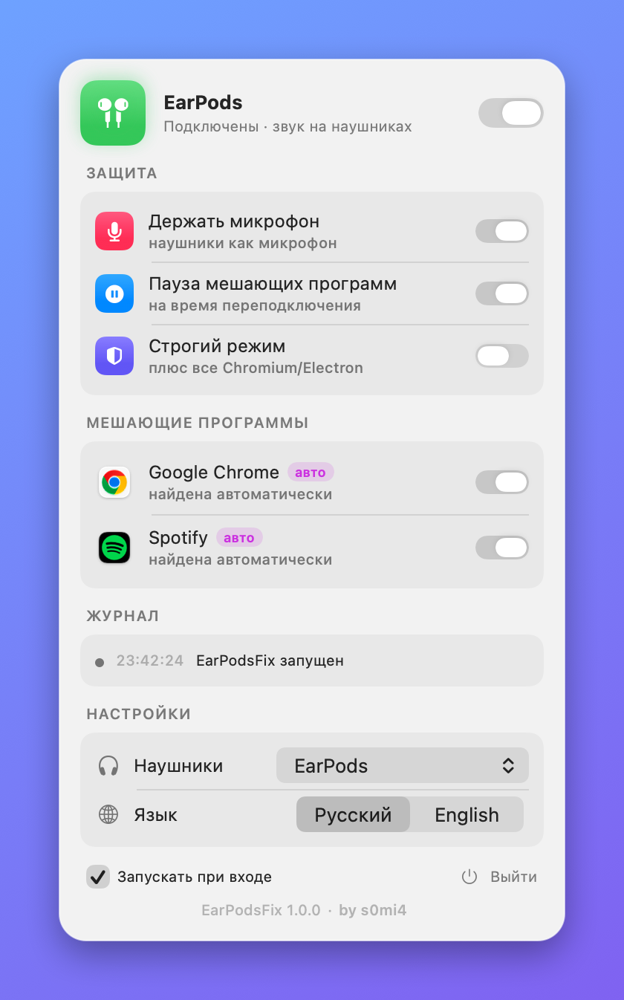

<p align="center">
  
</p>

<h1 align="center">EarPodsFix</h1>

<p align="center">
  Keeps your audio on USB-C headphones — without ever closing your apps.<br>
  <b>by <a href="https://github.com/s0mi4">s0mi4</a></b> · macOS 13+ · Apple Silicon &amp; Intel
</p>

<p align="center">
  <a href="../../releases/latest"><b>⬇ Download the latest release</b></a>
</p>

<p align="center"><a href="#english">English</a> · <a href="#русский">Русский</a></p>

<p align="center">
  
  &nbsp;&nbsp;
  
</p>

---

## English

### The problem
You plug in USB-C EarPods (or any other USB headset), and a few seconds later the sound jumps back to the MacBook speakers. Replugging doesn't help.

The reason: some apps (on the author's Mac — **Google Chrome** and **Spotify**) connect to the headphones' USB device the moment they are plugged in. The headphones stop responding, macOS can't create an audio device for them, and they simply disappear from the sound settings.

### What EarPodsFix does
- **Keeps audio on your headphones.** If any app switches the output, system sounds or microphone to another device, EarPodsFix switches it right back. It also restores the sample rate if an app changes it.
- **Finds interfering apps automatically.** There is no built-in list. EarPodsFix looks at which processes open your headphones' USB device and remembers them, so it also works for apps that you install later.
- **Protects the reconnect.** When you unplug the headphones, interfering apps are *paused* — not closed. As soon as macOS brings the headphones up, the apps continue exactly where they were. A pause never lasts longer than 30 seconds.
- **Strict mode** (optional) also pauses every running Chromium/Electron app, in case an interfering app hasn't been detected yet.
- Works with **any USB headphones** (`Auto (USB)`) or a specific device you pick.
- English and Russian interface, switchable in the app.

### Install
1. Download `EarPodsFix-x.y.z.dmg` from [Releases](../../releases/latest) and drag **EarPodsFix** into **Applications**.
2. The app is not notarized by Apple, so macOS will block the first launch. Open **System Settings → Privacy & Security** and click **Open Anyway**, or run:
   ```bash
   xattr -dr com.apple.quarantine /Applications/EarPodsFix.app
   ```
3. Click the EarPods icon in the menu bar and turn on **Launch at login**.

### How it works
| What | How |
|---|---|
| Keep the audio device | Listens to CoreAudio default-device changes and switches them back |
| Find interfering apps | Reads `IOUserClientCreator` of user clients attached to the headphones' USB device in the IORegistry |
| Pause / resume apps | `SIGSTOP` on unplug, `SIGCONT` once the audio device is back (max 30 s, always resumed on quit) |
| Never touches | macOS system processes (`/System`, `/usr`, …) |

EarPodsFix has no network access, collects nothing and needs no special permissions.

### Build from source
Requires Xcode or the Command Line Tools (`xcode-select --install`).
```bash
./release.sh 1.0.0
```
The result goes to `dist/`: a universal `EarPodsFix.app`, a `.zip` and a `.dmg`.

Releases are also built automatically by GitHub Actions when a tag like `v1.0.0` is pushed.

---

## Русский

### Проблема
Вы подключаете USB-C EarPods (или любые другие USB-наушники), а через пару секунд звук снова уходит в динамики MacBook. Переподключение не помогает.

Причина: некоторые программы (у автора это **Google Chrome** и **Spotify**) в момент подключения лезут к USB-устройству наушников. Наушники перестают отвечать, macOS не может создать для них звуковое устройство, и они просто пропадают из настроек звука.

### Что делает EarPodsFix
- **Держит звук на наушниках.** Если программа переключила вывод, системные звуки или микрофон на другое устройство, EarPodsFix сразу возвращает их обратно. Если программа поменяла частоту дискретизации, её тоже возвращает.
- **Сам находит мешающие программы.** Заранее заданного списка нет. EarPodsFix смотрит, какие процессы открыли USB-устройство наушников, и запоминает их, поэтому работает и с программами, которые вы установите потом.
- **Защищает переподключение.** Когда вы вынимаете наушники, мешающие программы ставятся *на паузу* — не закрываются. Как только macOS запустила наушники, программы продолжают работу с того же места. Пауза длится не больше 30 секунд.
- **Строгий режим** (по желанию) дополнительно ставит на паузу все программы на Chromium/Electron, на случай если мешающая программа ещё не найдена.
- Работает с **любыми USB-наушниками** («Авто (USB)») или с конкретным устройством.
- Интерфейс на русском и английском, язык переключается в приложении.

### Установка
1. Скачайте `EarPodsFix-x.y.z.dmg` из [Releases](../../releases/latest) и перетащите **EarPodsFix** в **Программы**.
2. Приложение не заверено Apple, поэтому первый запуск macOS заблокирует. Откройте **Системные настройки → Конфиденциальность и безопасность** и нажмите **Всё равно открыть**, или выполните:
   ```bash
   xattr -dr com.apple.quarantine /Applications/EarPodsFix.app
   ```
3. Нажмите на иконку EarPods в строке меню и включите **Запускать при входе**.

### Как это устроено
| Что | Как |
|---|---|
| Удержание звука | Следит за сменой устройства по умолчанию в CoreAudio и возвращает его |
| Поиск мешающих программ | Читает `IOUserClientCreator` у клиентов USB-устройства наушников в IORegistry |
| Пауза и продолжение | `SIGSTOP` при отключении, `SIGCONT`, когда звук вернулся (не дольше 30 с, при выходе пауза всегда снимается) |
| Никогда не трогает | Системные процессы macOS (`/System`, `/usr`, …) |

EarPodsFix не ходит в интернет, ничего не собирает и не требует особых разрешений.

### Сборка из исходников
Нужен Xcode или Command Line Tools (`xcode-select --install`).
```bash
./release.sh 1.0.0
```
Результат появится в `dist/`: универсальное `EarPodsFix.app`, а также `.zip` и `.dmg`.

Релизы также собираются автоматически через GitHub Actions при пуше тега вида `v1.0.0`.

---

<p align="center">MIT License · © 2026 <a href="https://github.com/s0mi4">s0mi4</a></p>
